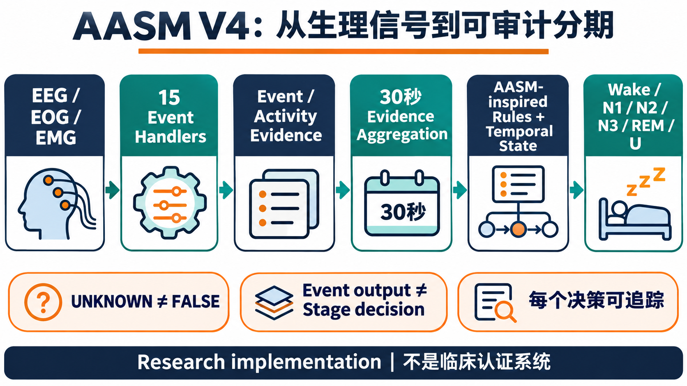
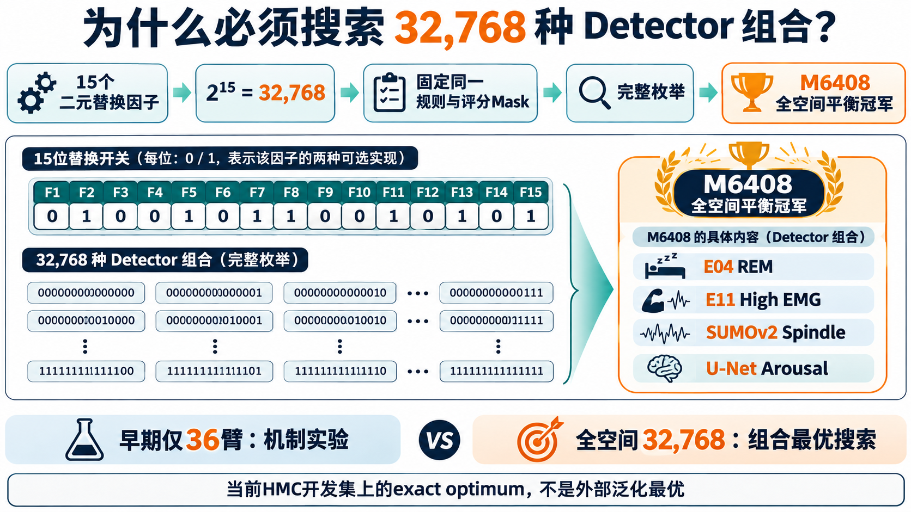
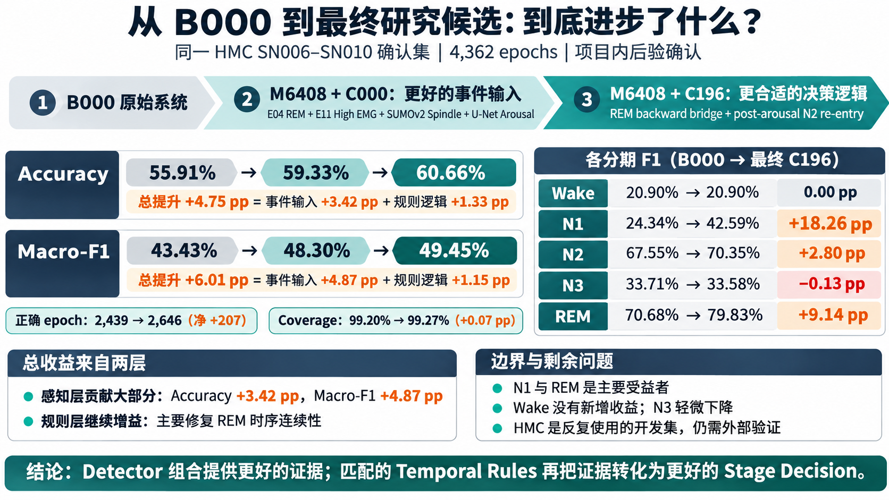
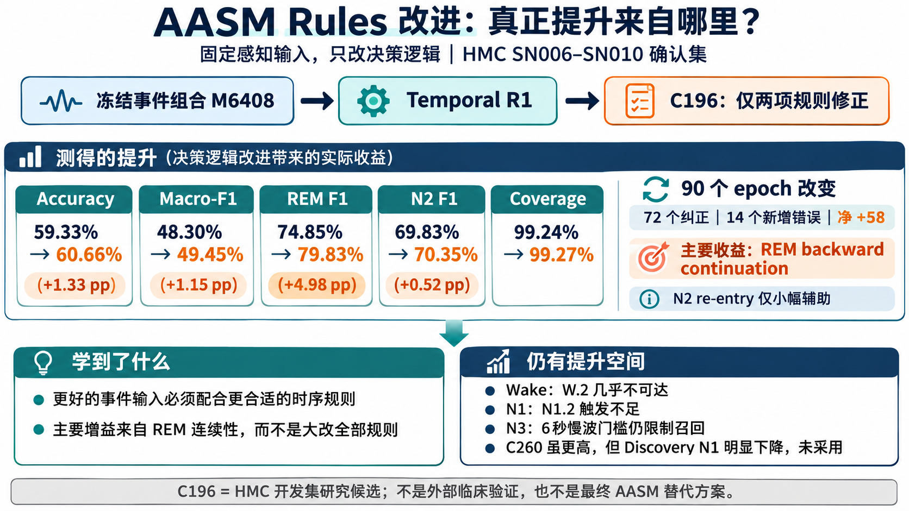
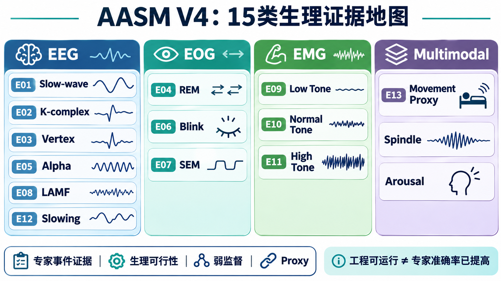
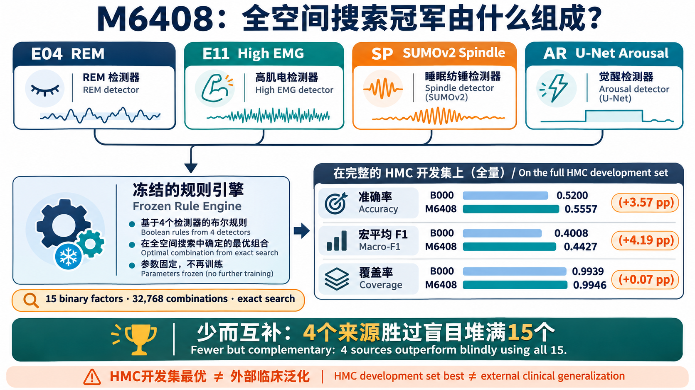
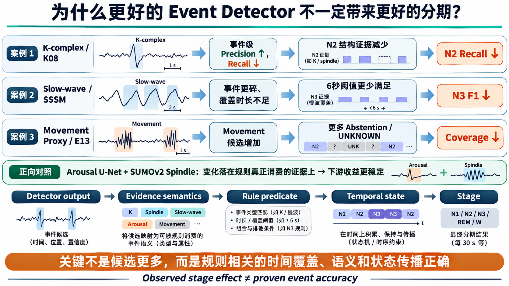
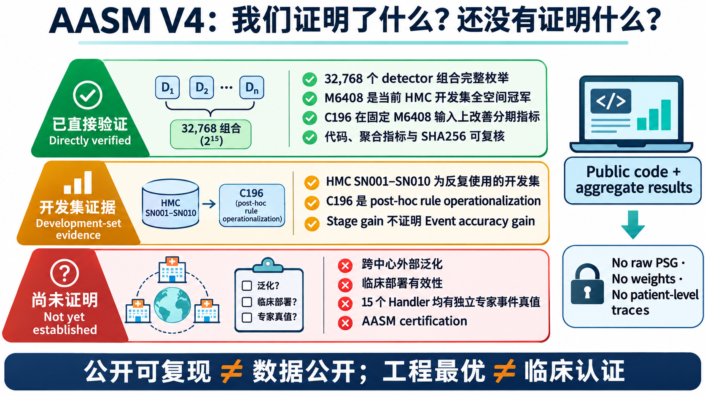

# AASM-inspired Sleep Staging V4

## Better event detectors, exhaustive subset search, and auditable temporal rules

本分支公开一条可审计的研究流水线：

**PSG signals → physiological events → epoch evidence → AASM-inspired rules → temporal state → sleep stage**

V4 不把“Detector 更强”直接等同于“分期一定更准”。它把三个问题分开验证：

1. 事件源能否在真实信号上产生可追溯输出；
2. 哪些 Detector 组合在冻结 Temporal R1 下真正有用；
3. 固定最优感知组合后，哪些有公开 AASM 依据的时序 operationalization 能进一步改善决策。

> **证据边界**：这是 AASM-inspired research implementation，不是 AASM 认证软件，
> 也不是临床部署系统。HMC 十晚在本项目中被反复用于开发；本分支所有 HMC 数字均为
> within-project development evidence，而不是外部盲测或跨中心临床验证。



## 结论先行

冻结 Temporal R1 后，我们完整评价了 **15 个可替换 Event/Evidence Handler 的全部
32,768 个组合**。Balanced champion 是：

```text
M_6408 = E04 REM + E11 High EMG + SUMOv2 Spindle + PSGScoring U-Net Arousal
```

在共同 8,902-epoch 开发集口径上：

| System | Accuracy | Macro-F1 | Coverage | 解释 |
|---|---:|---:|---:|---|
| B000 | 0.519996 | 0.400815 | 0.993934 | Frozen detector baseline |
| M_6408 | **0.555718** | **0.442729** | **0.994608** | 全 32,768 组合中的 balanced champion |
| Δ | **+0.035722** | **+0.041914** | **+0.000674** | 同 mask、同规则引擎 |

M_6408 并不是“15 个都换掉”。Full-15 的 Accuracy 下降，说明更多 Event Proposal
可以改善某些类别，同时通过持续时间、优先级、拒判和 temporal propagation 伤害其他类别。



## 从最优输入到更合适的决策逻辑

在固定 M_6408 后，V4 只搜索有公开 AASM 依据、且可在代码中明确追踪的规则变化。
最终候选 **C196** 相对 Temporal R1 只改变两个模块：

- `R.BACKWARD_BRIDGE`：对 REM 的 backward bridge 进行明确 operationalization；
- `N2_POST_AROUSAL_REENTRY`：结构性 N2 evidence 优先于旧的 post-arousal majority fallback。

候选先在 discovery half 选择，再冻结到 confirmation half。确认集结果为：

| System | Accuracy | Macro-F1 | Coverage |
|---|---:|---:|---:|
| B000 | 0.559147 | 0.434345 | 0.991976 |
| M_6408 + Temporal R1 | 0.593306 | 0.482999 | 0.992435 |
| M_6408 + C196 | **0.606602** | **0.494475** | **0.992664** |

在该 confirmation half 上，B000 → C196 为 Accuracy **+4.7455 percentage points**、
Macro-F1 **+6.0130 points**，净增加 **207** 个正确 epoch。相对同一 M_6408 输入的
Temporal R1，C196 额外带来 Accuracy **+1.3296 points** 和 Macro-F1 **+1.1476 points**。





这些结果支持“先优化感知输入，再优化其可消费的决策逻辑”，但仍属于
`WITHIN_PROJECT_POST_HOC_CONFIRMATION`。C196 是工程化 AASM operationalization，
不是新的临床规则标准。

## 15 类 Handler 的地位



V4 保留三个独立层次：

- **Event-level evidence**：有专家事件标注或明确弱监督协议；
- **Functional handler**：真实模型、真实信号、合法时序输出与可调用 Adapter；
- **Stage utility**：在冻结规则、共同 mask 下的 paired stage effect。

因此：

- SUMOv2 Spindle 与 U-Net Arousal 是最可靠的正向下游对照；
- R04 REM 是 M_6408 的组成部分，但不等于已获得跨数据集临床验证；
- K08 的 DREAMS 事件级收益没有转化为 N2 stage utility，是重要负结果；
- E13 始终标为 **movement proxy**，不是已验证的 Major Body Movement Detector；
- Phase 1C/1D 的 weak-teacher Handler 具备工程接口，但不等于专家事件准确率已获证明。



## 为什么“更好的 Event”有时会失败？

Event Proposal 进入最终 Stage 前，还要经过：

```text
event boundary / duration
        → epoch union coverage
        → evidence TRUE / FALSE / UNKNOWN
        → rule predicate and priority
        → temporal continuation / termination / inheritance
        → stage or UNDETERMINED
```

SSSM Slow-wave、K08 K-complex 和 movement proxy 分别暴露了 duration-threshold、
structure/association、coverage/abstention 三类失配。相反，Arousal 和 Spindle 更容易产生
当前规则真正消费的 evidence。Stage gain 不能反向证明 Event accuracy gain。



## 仓库结构

```text
src/aasm_v2/                         frozen Enhanced V2 heritage
src/aasm_temporal_r1/                frozen Temporal R1 heritage
src/aasm_v4/                         public V4 profiles, contracts, metrics
configs/v4/                          handler, detector, rule, protocol profiles
experiments/v4_handler_validation/   Phase 1C/1D handler engineering
experiments/v4_36arm_ablation/       36-arm controlled ablation
experiments/v4_subset_search/        hybrid search algorithm and sealed-cache interface
experiments/v4_exhaustive_search/    exact 2^15 subset evaluation
experiments/v4_mechanistic_attribution/
experiments/v4_rule_discovery/       evidence-bounded rule discovery
results/release/v4/                  aggregate public results only
reports/v4/                          scientific reports and decisions
educational_images/v4/               educational, non-evidentiary figures
tests/v4/                             portable release tests
```

原始 PSG、标签、模型权重、patient/night-level Event Banks、逐 epoch Prediction/Trace
及本机路径均不在公开分支。完整边界见 [release scope](provenance/v4/release_scope.json)
和 [third-party notices](THIRD_PARTY_NOTICES.md)。

## 快速复核

```powershell
python scripts/reproduce_v4.py
python scripts/validate_v4_release.py
python -m pytest tests/v4 -q
```

这些命令复算公开 aggregate artifacts、验证配置合同并检查发布树；它们不会下载受限数据，
也不会声称从 Raw PSG 复现患者级结果。需要完整封存数据和权重的受控 replay 入口保留在
实验模块中，使用者必须自行取得合法数据与第三方模型。

## 进一步阅读

- [V4 变更记录](CHANGELOG_V4.md)
- [V4 复现边界](REPRODUCIBILITY_V4.md)
- [36-arm 报告](reports/v4/phase2_36arm_report.md)
- [全空间搜索报告](reports/v4/exhaustive_search_report.md)
- [机制归因报告](reports/v4/mechanistic_analysis_report.md)
- [C196 规则发现报告](reports/v4/rule_discovery_report.md)
- [模型与第三方来源](model_cards/external_model_sources.json)
- [V4 Educational Images](educational_images/v4/README.md)

## V3 heritage

V4 继承 `AASM_Rule_V3_Event_Detectors_Improvement` 的 frozen core、Event Contract、
copy-on-write integration 与独立 detector evidence。V3 的完整说明与原图仍保留在该分支
历史中；V4 新增的是 15-source handler library、36-arm attribution、完整组合空间搜索以及
固定 champion 后的 evidence-bounded temporal-rule study。

代码沿用仓库 [GPLv3](LICENSE)。数据、论文实现和第三方模型分别遵循其上游许可；
本仓库不授予第三方数据或权重的再分发权。


