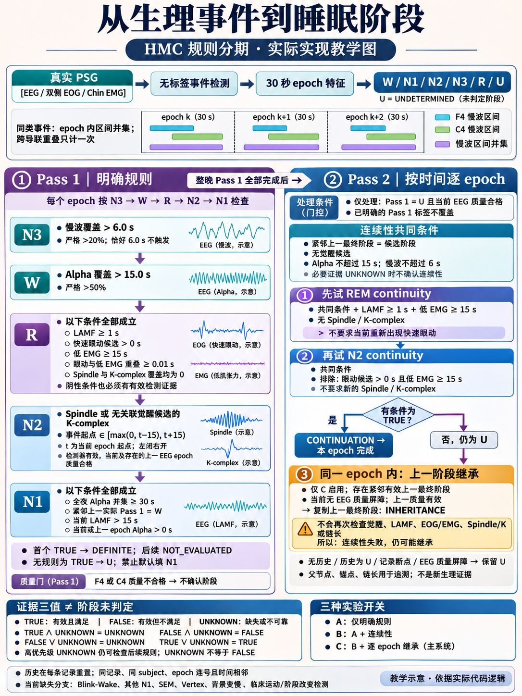
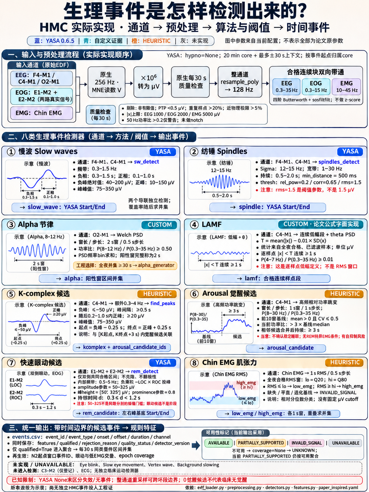

# HMC × Staging by the Book

确定性、paper-inspired 五阶段睡眠分期研究基线，独立于 COVER 训练/划分/评估。本公开备份包含原科学源码、配置、测试、方法审计、两张教学图及 **151 晚总体汇总指标**。

**公开范围：**不发布逐 epoch 人工标签/预测、逐记录临床结果、原始或派生临床波形、原始 PSG、完整推理缓存。完整本地证据备份保留在原工作区；本公开仓库不声称能够独立重建患者级评价时间轴或续跑原冻结缓存。

## Repository structure

```text
hmc-staging-by-the-book/
├── data/                 # 数据清单、校验信息与下载说明，不含原始 PSG
├── configs/              # 检测器阈值、分期规则与评估配置
├── src/                  # EDF 读取、预处理、事件检测、规则引擎与评估
├── scripts/              # CLI 入口：download、predict、evaluate、ablation、audit
├── tests/                # 自动化测试与标签隔离测试
├── results/              # 冻结配置、指标、混淆矩阵与消融结果
├── reports/              # 最终研究报告与 Implementation Audit
├── educational_images/   # 两张教学图及对应生成提示词
├── references/           # 论文、数据集与 YASA 的来源和版本记录
├── requirements.lock.txt # 精确依赖版本
├── .gitignore            # 排除原始数据、环境、缓存及大型运行产物
├── LICENSE
└── README.md             # 项目介绍、真实结果、局限与复现命令
```

另含 src 布局安装文件 `pyproject.toml` 及公共文件校验清单 `BACKUP_MANIFEST.json`。GitHub 仓库实际名称为 EEG_SleeP_Staging_AASM_Rules，上图为项目逻辑名称。

## 已完成的历史真实评测（总体汇总）

| 窗口 | 记录数 | Epochs | Accuracy | Cohen's κ | Macro-F1 |
|---|---:|---:|---:|---:|---:|
| Primary：首末可靠非 Wake 之间 | 151 | 131,673 | 49.8546% | 0.245636 | 0.357505 |
| Full valid record | 151 | 137,243 | 49.0043% | 0.248767 | 0.362414 |

来源：[总体指标](results/full_v1/overall_metrics.json)、[5×6 混淆矩阵](results/full_v1/confusion_matrix.csv)。UNDETERMINED 保留并计错；两个评分格式是同份人工评分的两种表示。

| 变体 | 内容 | Primary Accuracy | κ | Macro-F1 |
|---|---|---:|---:|---:|
| A | 明确规则 | 37.2392% | 0.194252 | 0.302474 |
| B | A + continuity | 47.2010% | 0.227105 | 0.318484 |
| C | B + inheritance | 49.8546% | 0.245636 | 0.357505 |

各变体的汇总指标在 results/full_v1/ablations/。本公开备份仅复算汇总矩阵，不包含逐 epoch 预测证据。

## 实际方法与限制

真实 EEG / 双侧 EOG / Chin EMG → 原生 QC → 128 Hz 重采样、合格块滤波 → 生理候选事件 → 30 s 区间并集 → 全夜 Pass 1（N3/W/R/N2/N1）→ 顺序 Pass 2（R/N2 continuity，每 epoch 末可继承）。源码未改阈值或算法。

- 没有监督阶段分类器或 LLM 补标签，没有 `else: N1`。
- 继承没有最大链长/锚点年龄上限，可在 continuity 失败后发生；条件 UNKNOWN 与最终阶段 U 必须区分。
- K/arousal、EMG 分位数及部分信号具体化包含 heuristic；无独立 HMC 人工事件级验证。
- arousal 全量零候选且有滚动基线自抑制反例；YASA None 存在失效/无事件歧义；整通道重采样可跨质量边界。
- Blink/SEM/vertex/background slowing 等分支未实现；N1 primary recall 仅0.1029%。
- subject_id 是记录代理；未证实真实患者跨夜独立性。记录协议声明未按分数调参，当前核心与冻结指纹一致，但历史完整因果顺序不能由本公开备份独立证明。

[完整实现审计（公开文本版）](reports/HMC_Rule_Based_Implementation_Audit.md) · [方法映射](reports/PAPER_METHOD_MAPPING.md) · [公开研究结果](reports/FINAL_RESEARCH_REPORT.md)

## Educational Images

两图均为 imagegen 教学示意，不是 HMC 实测临床波形；对应 .prompt.md 保存生成依据。





## 安装与运行

精确历史解释器为 Python3.12.14；其他依赖组合未验证。源码语法≥3.10。

```powershell
python -m venv .venv
.\.venv\Scripts\python.exe -m pip install -r requirements.lock.txt
.\.venv\Scripts\python.exe -m pip install --no-deps -e .
$env:PYTHONUTF8 = '1'
$env:MNE_USE_NUMBA = 'false'
.\.venv\Scripts\python.exe scripts/recheck_results.py --run-dir results/full_v1
.\.venv\Scripts\python.exe -m pytest -q --basetemp=.runtime_tmp/pytest
```

recheck_results 只从总体5×6矩阵复算 Accuracy、κ、Macro-F1，不读取个人级标签/信号。当前相关测试39 passed、3 skipped；跳过项依赖未公开的原始PSG/完整缓存。科学源码和两张图与已审计版本字节一致。

下载官方 HMC 后可从头运行（默认数据目录被 Git 忽略）：

```powershell
.\.venv\Scripts\python.exe scripts/download.py --subset smoke
.\.venv\Scripts\python.exe scripts/predict.py --subset smoke --run-dir results/new_smoke
.\.venv\Scripts\python.exe scripts/evaluate.py --run-dir results/new_smoke
.\.venv\Scripts\python.exe scripts/ablation.py --run-dir results/new_smoke
.\.venv\Scripts\python.exe scripts/audit.py --run-dir results/new_smoke
```

pilot/all 使用相应 --subset 和新的结果目录。不要用历史汇总目录替代完整推理缓存。当前外层预测依赖已校验下载元信息，底层 predict_one 不读取人工阶段内容。

## 来源与许可

- [论文 v1](https://arxiv.org/html/2605.22859v1)：49晚测试、十专家共识，参考60.5%/κ0.42；HMC是外部评估，不能直接视为严格复现成败。
- [官方 HMC v1.1](https://physionet.org/content/hmc-sleep-staging/1.1/)：151晚临床PSG、AASM2.4；引用 Alvarez-Estevez & Rijsman (2022)，DOI10.13026/t79q-fr32。官方元信息及许可保存在data/，不含临床信号/评分文件。
- 代码沿用 [GPLv3](LICENSE)；YASA审计引用源码保留BSD许可。其他来源见references/。
- 预测核心SHA256：6f96c0ba0ab4c1f1facc086075b6398de01ebbdbdd0c9d7c90eafd7e1c587d6a。
