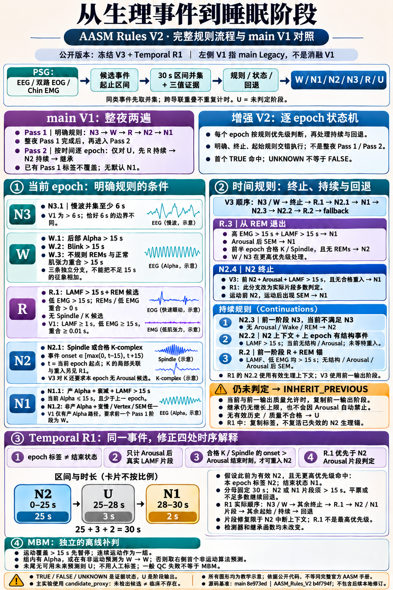
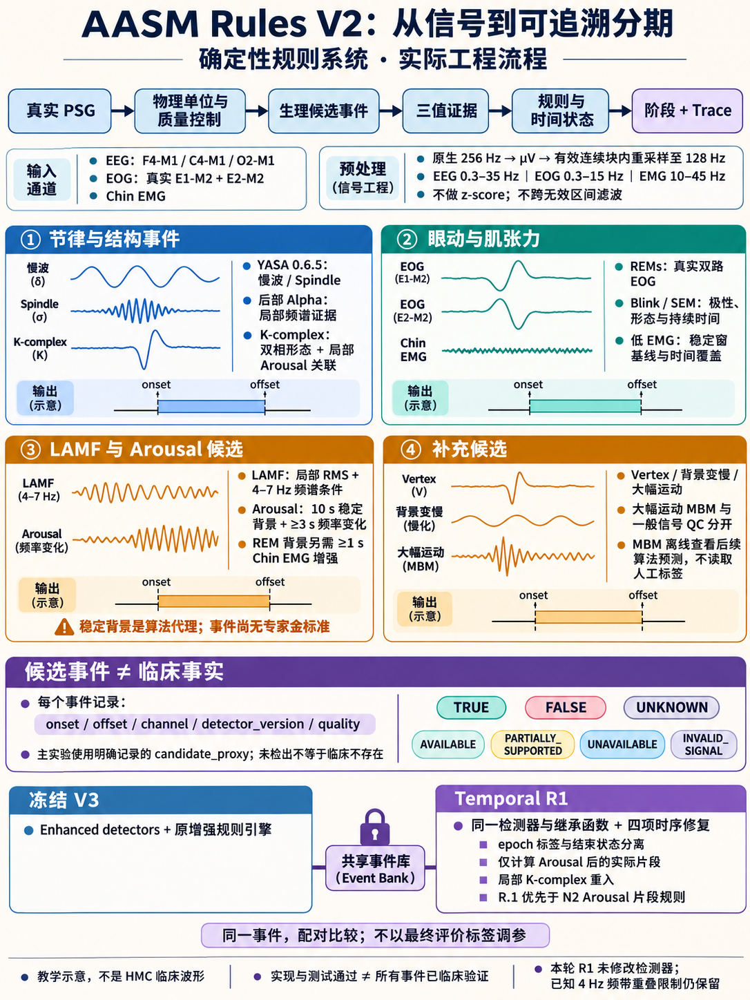
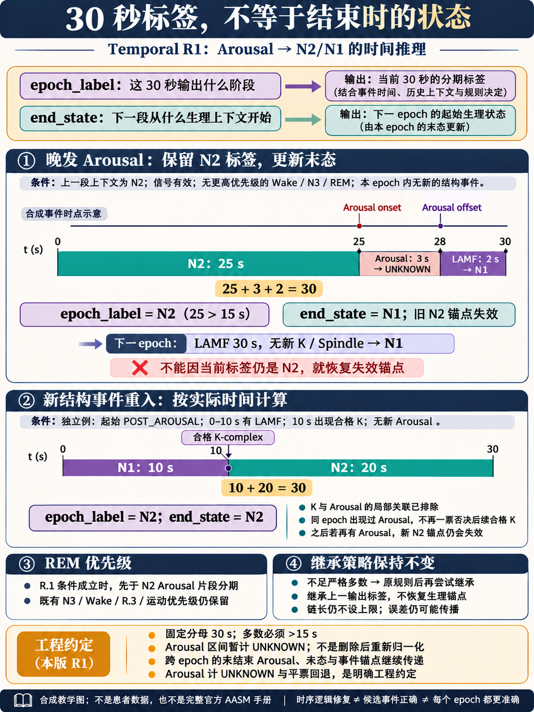

# Enhanced AASM Rule-Based Sleep Staging V2

从真实 PSG 生理候选事件产生五阶段睡眠分期的确定性研究工程。`AASM_Rules_V2` 分支基于 main 的公开交付形式整理；main 保留原 Legacy 基线。本分支包含独立重建的 V2、冻结的151晚历史对照、以及后续 **Temporal R1 时序修正版的10晚开发集验证**。

**结果并非全面改善。** 冻结 V3 全量 Accuracy 为48.5840%，低于 Legacy 的49.8546%，也低于 V1 的53.1696%。后续 R1 在固定开发集将 V3 的49.0002%提高到51.9996%，但仍低于同批V1的54.9090%。R1尚未运行最终141条或全151条评价。

## 项目结构

```text
AASM_Rules_V2/
├── data/                 # 官方清单、SHA256、许可与本地数据说明；无PSG/评分
├── configs/              # 冻结检测参数、记录划分、规则修订协议与代码指纹
├── src/
│   ├── aasm_v2/          # 冻结V2：读取、预处理、事件、证据、规则、provenance
│   └── aasm_temporal_r1/ # 独立修正：片段时序、结束状态、重入与优先级
├── scripts/              # predict / evaluate / ablation / audit / recheck_results
├── tests/                # 检测器、规则、合成时序、标签隔离与指标测试
├── results/
│   ├── frozen_v2/        # 151晚冻结总体指标与消融；混淆矩阵存于metrics.json
│   └── temporal_r1_development/ # 10晚开发集总体指标、配对变化与测试证据
├── reports/              # 方法、十二项状态、真实结果、时序审计与复现说明
├── educational_images/   # 三张合成教学图、初始提示词及修正提示词
├── references/           # main来源、论文/数据/YASA版本、规则版本说明
├── requirements.lock.txt # 实测Python环境的精确依赖
├── pyproject.toml
├── .gitignore            # 排除PSG、标签、环境、缓存与详细临床产物
├── .gitattributes        # 保留冻结源码/配置的字节哈希
├── LICENSE
└── README.md
```

## 怎样从输入产生输出

真实EEG、双侧EOG和Chin EMG → μV单位、原生QC、有效连续块预处理 → 候选事件起止区间 → 三值证据 → 明确规则、时序状态与回退 → 阶段和Trace。没有神经网络或LLM阶段分类器。主实验的候选阴性代理明确记录，不能将其解释为临床事件不存在。

R1仅修改四件事：epoch标签与结束状态分离；Arousal后实际片段计时；局部合格K-complex重入；R.1优先于N2 Arousal片段。**所有检测器、参数、预处理及无界继承函数不变。** 详见[实际方法](reports/01_methods.md)与[时序修复结果](reports/04_temporal_revision.md)。

## 从生理事件到睡眠阶段：完整规则图

**先分清执行方式：main 的 Legacy V1 是“全夜 Pass 1 明确规则，再按时间逐 epoch 做 Pass 2”；增强 V2 是逐 epoch 状态机，并不是给同一套两遍流程增加几个条件。** 图中的 V1 指 main Legacy，不是下方消融表中“Enhanced detectors + original-style engine”的 V1。公开分支同时保留冻结 V3 和 Temporal R1，图中分别标出二者，不混入后续未发布修订。



[打开高清原图](educational_images/v2_rule_flow_comparison.png) · [逐条条件、执行顺序与源码对应](reports/05_rule_flow_comparison.md) · [main V1 原教学图](https://github.com/Kevin11Kaikai/EEG_SleeP_Staging_AASM_Rules/blob/8e973edb85eb4b9a9cadcb3adbb855b484d477c1/educational_images/hmc_rule_staging_educational_v1.png)

|比较点|main Legacy V1|增强 V2 / Temporal R1|
|---|---|---|
|执行顺序|整夜明确规则完成后，仅对 U 做 REM/N2 continuity 和继承|每个 epoch 按明确、终止、起始、持续规则的实际优先级判断，再回退|
|N3 / Wake|慢波严格 >6 s；Wake 只有 Alpha 分支|慢波 ≥6 s；W.1 Alpha、W.2 Blink、W.3 不规则眼动与肌张力，三条独立分支|
|REM 起始|LAMF ≥1 s、低EMG ≥15 s、眼动/低EMG重合 ≥0.01 s|LAMF >15 s、低EMG >15 s、重合 >0 s；另有 R.3 终止和 R.2 持续|
|N1 / N2|N1 仅 Alpha 路径；N2 起始与简化持续|双 N1 路径；N2.1–N2.4；R1 进一步按实际 Arousal/LAMF/结构事件边界处理 N2 中断|
|回退与边界|可在 continuity 失败后继承；无最大链长|主系统继承仍无界；R1 分离输出标签与 N2 生理末态，不能据此宣称传播问题已消失|
|大幅运动|没有独立 MBM 临床分期分支|连续 MBM 块离线补判，只使用算法预测的未来阶段|

图中 **25 s N2 + 3 s U + 2 s N1** 是合成时序示例，卡片不按时间比例绘制。`UNKNOWN` 是证据状态，`U` 是阶段输出；主实验 `candidate_proxy` 的“无候选”不等于临床事件不存在。完整条件以链接的源码与文字说明为准。

## 冻结历史对照：151晚，同一131,673 primary epochs

|方法|事件检测器 / 规则引擎|Accuracy|Macro-F1|κ|
|---|---|---:|---:|---:|
|Legacy|原冻结基线|49.8546%|0.357505|0.245636|
|V0|旧规格独立重建 / original-style|49.8530%|0.357475|0.245600|
|V1|Enhanced / original-style|53.1696%|0.406007|0.305709|
|V2|Original-style / enhanced|46.0778%|0.282926|0.178770|
|V3|Enhanced / enhanced|48.5840%|0.423892|0.282917|
|V4|V3，Abstention回退|42.4802%|0.397478|0.246443|

V4 Coverage=78.9691%，Conditional Accuracy=53.7935%，Accepted risk=46.2065%；表中Accuracy将拒绝计错。V0与Legacy并非逐样本完全相同，不能将V0重建误差算作增强收益。全量对照是历史比较，不是全新外部盲测。完整范围与指标在[冻结汇总](results/frozen_v2/metrics.json)。

## Temporal R1：固定10晚开发集，同一8,902 primary epochs

|方法|Accuracy|Macro-F1|κ|Coverage|
|---|---:|---:|---:|---:|
|冻结V1|54.9090%|0.368825|0.301538|99.0789%|
|冻结V3|49.0002%|0.396051|0.268743|99.3597%|
|R1|51.9996%|0.400815|0.292166|99.3934%|

R1−V3：纠正378、新增错误111、净+267（+2.9993pp）；R1−V1：净−259（−2.9095pp）。主要增益是N2，N1召回、N3和REM存在退步；[完整结果](reports/03_results.md)保留这些负结果。软件时序修复不证明Arousal/K候选正确，也没有消除长期传播。

31项新增时序测试通过；公开包整合测试94项通过。开发集重读10晚真实EDF，事件、聚合证据和完整冻结V1/V3输出精确一致；预测封存后评价。只读独立sklearn复算通过。未使用最终评价标签选择本轮参数或方法。

## Educational images

三图使用内置imagegen生成，均为合成教学示意，没有临床波形或个人数据。上方的[完整规则对照图](educational_images/v2_rule_flow_comparison.png)解释 main V1 的两遍 Pass、V2 状态机和 R1 差异；下方两图分别补充事件检测流程与局部时序修复。生成提示词和定点修正记录保存在同目录；图片说明不能替代源代码。





## 安装、验证与本地复现

实测解释器Python3.12.14。其他依赖组合未经验证；MNE在NumPy2.5下有已观察到的deprecation warnings，相关测试仍通过。

```powershell
python -m venv .venv
.\.venv\Scripts\python.exe -m pip install -r requirements.lock.txt
.\.venv\Scripts\python.exe -m pip install --no-deps -e .
$env:PYTHONDONTWRITEBYTECODE='1'
$env:PYTHONUTF8='1'
.\.venv\Scripts\python.exe -m pytest -q -p no:cacheprovider
.\.venv\Scripts\python.exe scripts/audit.py
.\.venv\Scripts\python.exe scripts/recheck_results.py
.\.venv\Scripts\python.exe scripts/ablation.py
```

使用已下载HMC v1.1；以下路径按本地位置替换。预测与评价分开，输出到被忽略的本地目录：

```powershell
python scripts/predict.py --psg X:/HMC/recordings/SN001.edf --run-dir results/local/new_smoke
python scripts/evaluate.py --data-dir X:/HMC/recordings --run-dir results/local/new_smoke
```

`predict.py`计算冻结V0–V4及R1，保持两个预测文件和各自校验记录。`evaluate.py`只评价指定目录中的已完成记录，核对TXT/EDF+一致且完整的30秒评分；primary为首末可靠非Wake之间。`download.py`仅提供官方获取说明，不会自动下载15GB。

公开包可以复算总体指标、运行合成测试，并在合法持有原始数据后从头预测。它不包含原历史逐epoch时间轴，因此不能仅凭公开文件独立重建所有历史配对结果或恢复私人checkpoint。

## 限制与公开范围

- HMC无本项目独立专家事件金标准；Arousal、K、Blink、SEM、Vertex和MBM等保留experimental/partially supported状态。十二工作包的独立Accuracy贡献未逐项识别。
- 已知4Hz频带重叠、稳定睡眠背景代理及事件混淆仍保留，未在本轮顺手修检测器。
- 无界继承不变；“旧继承变为显式片段规则”不等于错误传播消失。
- 官方AASM手册、Table S2操作化和HMC评分版本须分别理解；R1的UNKNOWN区间和平票回退为工程约定。[来源说明](references/README.md)
- 置信区间按recording聚类，不是patient-level；开发记录重复使用，不能包装为盲测。
- 不公开PSG、评分、逐epoch预测、逐记录临床结果、详细trace或实测波形。临床内容保留在本地研究工程中。[发布范围](reports/00_release_scope.md)

代码沿用main的[GPLv3](LICENSE)；数据及YASA许可分别保留。所有正式数字均来自保存的汇总产物，不以教学图作为数值证据。
