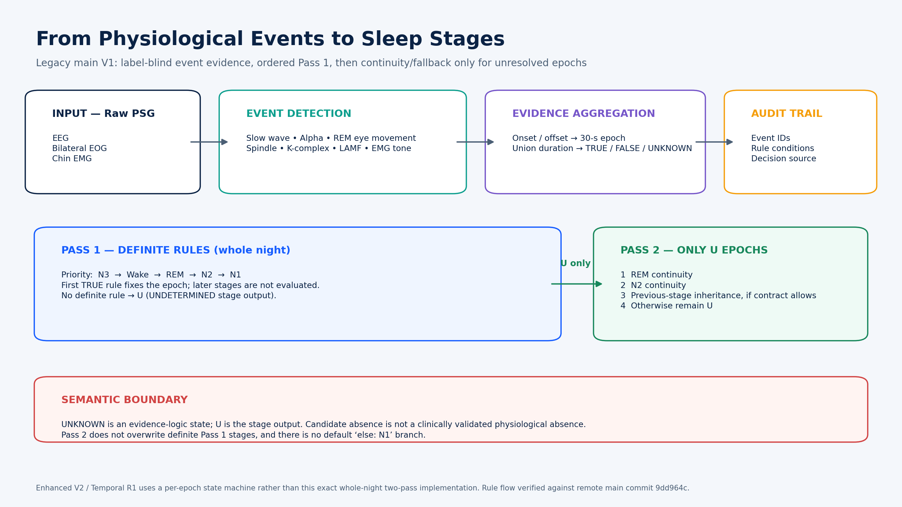
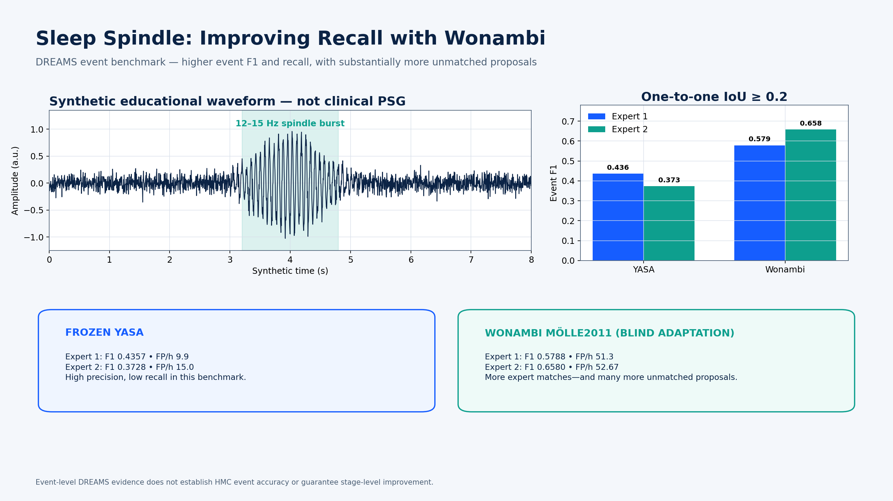
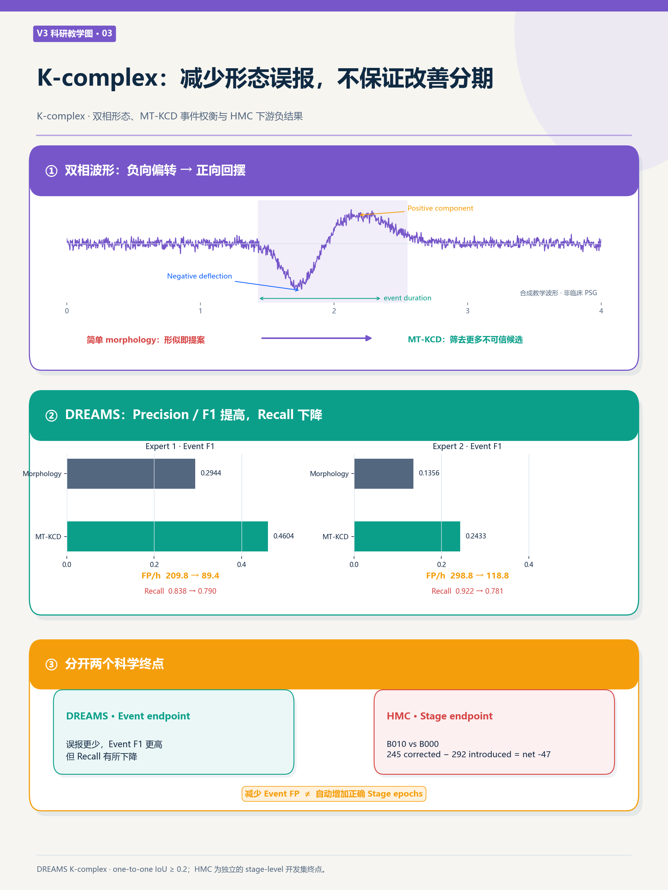
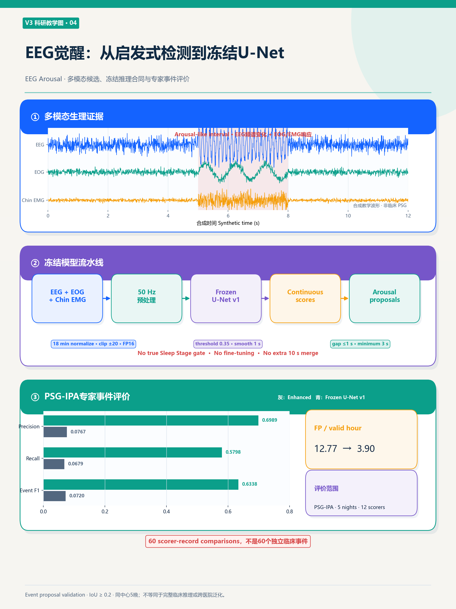
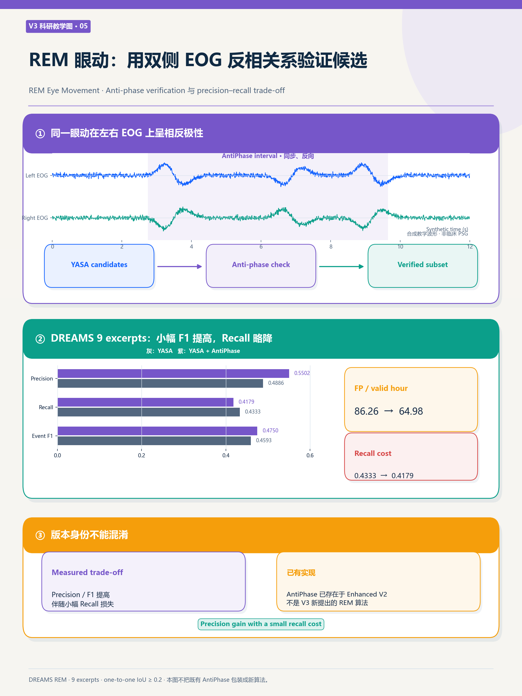
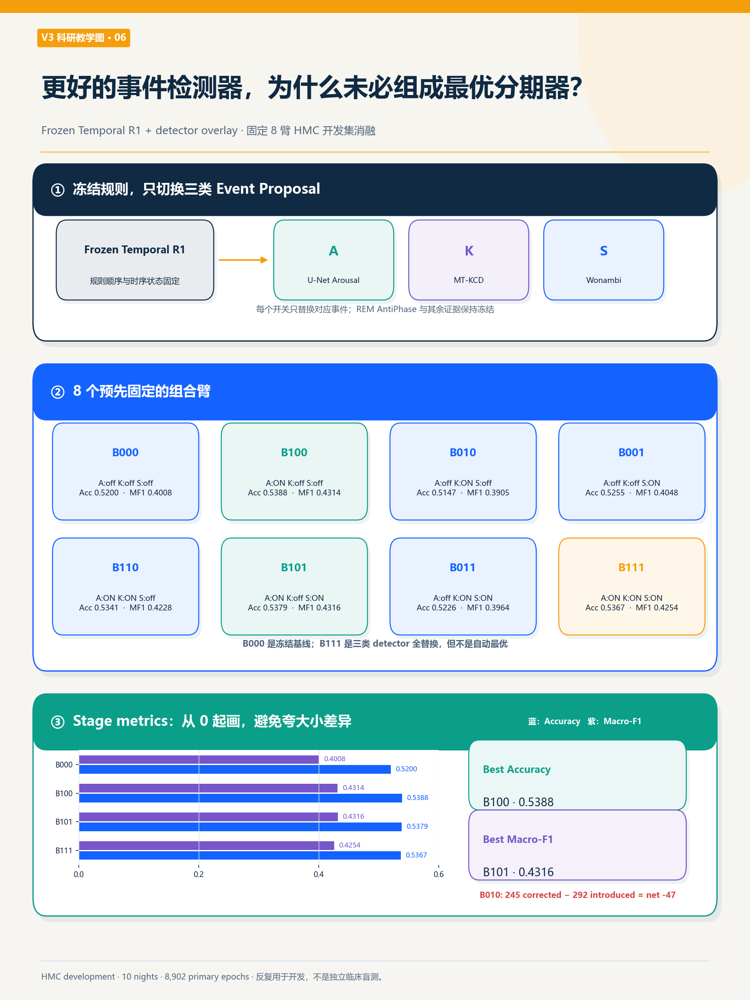
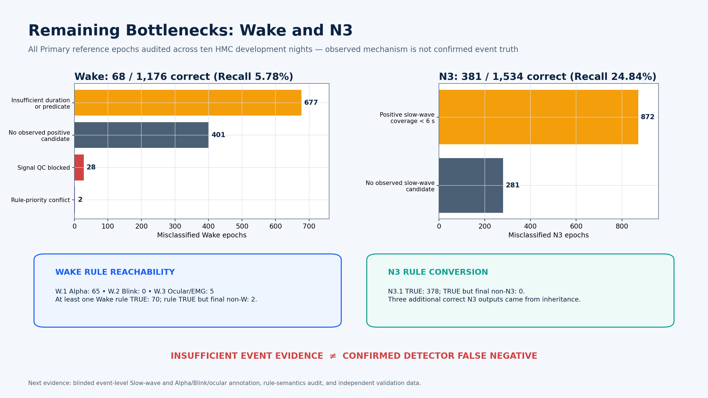

# AASM Rule-Based Sleep Staging V3 — Improved Physiological Event Detectors

## From Physiological Events to Auditable Sleep Staging Decisions

这是一个从真实 PSG 生理信号出发的、可审计的 AASM-inspired 睡眠分期研究实现：

**Raw PSG → Physiological Event Detection → Event Evidence → AASM-inspired Rules → Temporal Reasoning → Sleep Stages**

本发布不把睡眠分期当成黑箱分类。每个阶段决策都可以回溯到候选事件、30 秒
Evidence、规则条件和 Temporal State。V3 的研究问题不是“加入更多 Detector
能否让分数必然变高”，而是：**独立评测过的事件提议进入冻结规则后，哪些决策被
纠正，哪些被破坏，为什么？**

> **证据边界：**这是研究级 AASM-inspired 实现，不是完整 AASM 临床手册的认证实现，
> 也不是临床部署系统。HMC SN001–SN010 是反复使用的开发集，不是独立盲测。



[打开可编辑 SVG](educational_images/v3_01_events_to_stages_pass1_pass2.svg) ·
[绘图源代码](scripts/generate_v3_educational_images.py) ·
[图像生成与复核记录](educational_images/v3_CREATION_NOTES.md)

## 系统如何从输入产生输出

Legacy `main` V1 先在整夜执行不可变 Pass 1：`N3 → Wake → REM → N2 → N1`。
首个 TRUE 规则固定该 Epoch；无明确规则输出 `UNDETERMINED`。整夜 Pass 1 完成后，
Pass 2 只处理仍未确定的 Epoch，依次检查 REM continuity、N2 continuity，并在冻结
合同允许时继承 previous stage；否则继续保持 U。它没有默认 `else: N1`。

`UNKNOWN` 是 Evidence 的三值逻辑状态，`UNDETERMINED` 是 Stage 输出；没有候选不能
解释为临床确认“事件不存在”。以上语义已对远程 `main` commit
`9dd964c2ecdcd1ab2b305278876598d3bccbc014` 的实际源码复核。

Enhanced V2 / Temporal R1 并不是在这套整夜两遍流程上简单加条件，而是逐 Epoch
状态机。已有图继续保留：

- [Legacy V1 / Enhanced V2 / Temporal R1 对照](educational_images/v2_rule_flow_comparison.png)
- [Enhanced V2 pipeline](educational_images/v2_pipeline.png)
- [Temporal R1 时序修复](educational_images/temporal_r1.png)

## 先消除“V1 / V3”命名歧义

| 名称 | 本仓库中的准确含义 |
|---|---|
| `main Legacy V1` | 原始整夜 Pass 1 + Pass 2 规则流水线。 |
| `AASM_Rules_V2` | 增强事件、增强规则和后续 Temporal R1 的源分支。 |
| V2 experimental `V1` | Enhanced detectors + original-style engine；不是 main Legacy V1。 |
| V2 experimental `V3` | Enhanced detectors + enhanced engine；不是本发布分支。 |
| `Temporal R1` | 在冻结事件检测器上修复片段时序、重入和优先级的开发集版本。 |
| `B000–B111` | 固定 Temporal R1，只切换 Arousal/K-complex/Spindle Detector 的 8 个受控实验臂。 |
| `AASM_Rule_V3_Event_Detectors_Improvement` | 本次研究整理与公开发布分支。 |

发布名 V3 表示新的研究发布版本，**不等于** V2 中已有的 experimental V3 消融。

## 为什么改进 Event Detector？

规则引擎只能使用它看见的生理 Evidence。旧 Detector 可能漏掉候选、产生过多候选、
错位事件边界、依赖特定 Montage，或在 QC 无效时给出不可解释的阴性。问题是：

> **Event-level improvement ≠ Stage-level improvement.**

Event proposal 进入分期前，还会经过 QC、30 秒 union duration、复合 Evidence、
K–Arousal association、规则优先级、continuation/termination 和 inheritance。因而跨数据集
更高的 Event F1 可以改善、无效，甚至伤害最终 Stage。

## Physiological Event Detector 证据总览

| Event | Frozen / reference | Alternative | 独立 Event 证据 | HMC 下游结论 |
|---|---|---|---|---|
| Spindle | YASA V1-compatible | Wonambi Mölle2011 | DREAMS 两位专家下 Recall/F1 提高，FP/hour 大幅增加 | R1 B001 净 +49；更早 V1-style 实验净 −8，结果依赖规则引擎。 |
| K-complex | Frozen morphology | ScoringHero MT-KCD | DREAMS Precision/F1 提高、FP/hour 下降、Recall 下降 | R1 B010 净 −47；HMC transfer-unvalidated。 |
| Arousal | Frozen Enhanced | PSGScoring U-Net v1 | PSG-IPA 五晚、12 scorers：F1 0.0720 → 0.6338 | R1 B100 净 +167，为最大单因子变化。 |
| REM eye movement | Frozen YASA | YASA + AntiPhase | DREAMS F1 0.4593 → 0.4750，FP/hour 下降 | 已存在于 Enhanced V2；不是本次新增 Detector。 |

机器可读的全部精确数值、输入 artifact SHA256 和 Evidence Boundary 见
[`reports/v3_evidence_summary.json`](reports/v3_evidence_summary.json)。

## 1. Sleep Spindle：提高 Recall，也增加 False Proposals



在 DREAMS、IoU ≥ 0.2 下，Wonambi 对 Expert 1 的 F1 从 0.4357 提高到
0.5788，对 Expert 2 从 0.3728 提高到 0.6580；FP/hour 分别从 9.9/15.0
升到 51.3/52.67。正确结论是“该数据集上的 Recall/F1–FP trade-off 改善”，而不是
“Wonambi 已在 HMC 获得专家 Event 验证”。

[完整 Spindle/K/Arousal/REM Event 表](reports/v3_event_detector_evidence.md)

## 2. K-complex：减少 Morphology 过多提议



MT-KCD 对 DREAMS Expert 1 的 F1 从 0.2944 提高到 0.4604，FP/hour 从
209.8 降到 89.4；对 Expert 2 的 F1 从 0.1356 提高到 0.2433，FP/hour
从 298.8 降到 118.8。Recall 同时下降。HMC 中 B010 相对 B000 为 245
corrected / 292 introduced，净 −47；减少旧 Morphology 候选不保证经过
K–Arousal association 后的 Stage 决策改善。

ScoringHero MT-KCD 是 AGPL-3.0-only。本分支不复制其源码，只公开自有的
Detector-neutral event contract、上游身份和非分发说明。

## 3. Arousal：最大的 Event 与下游变化



PSGScoring Frozen U-Net v1 固定使用 EEG + EOG + Chin EMG、50 Hz、18 分钟
normalization、clip ±20、FP16 round-trip、threshold 0.35、1 秒 smoothing、gap
merge ≤1 秒、minimum duration 3 秒。主实验没有真实 Sleep Stage gate、没有额外
10 秒 merge、没有 fine-tuning。

五晚、12 scorers、60 个 scorer-record units 下，Event Precision/Recall/F1 为
0.6989/0.5798/0.6338；Frozen Enhanced 为 0.0767/0.0679/0.0720。TP/FP/FN
是 scorer-record 聚合，不是独立临床事件数。这是 Event Proposal 证据，不是完整临床
推理 Pipeline。

## 4. REM Eye Movement：AntiPhase 独立验证



DREAMS 下 YASA + AntiPhase 将 Event F1 从 0.4593 提高到 0.4750，FP/hour
从 86.26 降到 64.98，Recall 从 0.4333 降到 0.4179。Enhanced V2 已经实现
AntiPhase；V3 的价值是整理独立 Event-level Evidence，不把旧实现包装成新贡献。

## 完整集成：Better Events 进入冻结 AASM Rules 后发生什么？



固定 Temporal R1、Primary 8,902 epochs：

| Arm | Arousal U-Net | K MT-KCD | Spindle Wonambi | Accuracy | Macro-F1 | κ |
|---|:---:|:---:|:---:|---:|---:|---:|
| B000 | — | — | — | 0.5200 | 0.4008 | 0.2922 |
| B100 | ✓ | — | — | **0.5388** | 0.4314 | **0.3334** |
| B010 | — | ✓ | — | 0.5147 | 0.3905 | 0.2781 |
| B001 | — | — | ✓ | 0.5255 | 0.4048 | 0.2977 |
| B110 | ✓ | ✓ | — | 0.5341 | 0.4228 | 0.3174 |
| B101 | ✓ | — | ✓ | 0.5379 | **0.4316** | 0.3304 |
| B011 | — | ✓ | ✓ | 0.5226 | 0.3964 | 0.2864 |
| B111 | ✓ | ✓ | ✓ | 0.5367 | 0.4254 | 0.3188 |

结论：B100 的 Accuracy 最高，B101 的 Macro-F1 最高，B111 不是最优组合。
同批历史 Frozen V1 Accuracy 为 54.9090%，仍高于 B100 的 53.8755%；但 V1 与
R1 的规则引擎不同，不能把它们解释为只差 Detector。

### B000 vs B111 Stage-wise Performance

| Stage | B000 P / R / F1 | B111 P / R / F1 |
|---|---:|---:|
| Wake | .9714 / .0578 / .1091 | .9714 / .0578 / .1091 |
| N1 | .2130 / .2431 / .2270 | .3251 / .4160 / .3650 |
| N2 | .5071 / .8552 / .6367 | .5168 / .8660 / .6473 |
| N3 | .6513 / .2484 / .3596 | .6473 / .2464 / .3569 |
| REM | .8827 / .5420 / .6716 | .9139 / .5028 / .6487 |

B111 相对 B000：708 corrected、559 introduced、净 +149；N1/N2 改善，REM/N3
退步，Wake 不变。完整八臂、paired changes、Event counts 和机制见
[`reports/v3_full_integration_results.md`](reports/v3_full_integration_results.md)。

## 仍未解决：Wake 与 N3



Wake 1,176 个参考 Epoch 中正确 68 个，Recall 5.7823%；W.1/W.2/W.3 可达
65/0/5 个。N3 1,534 个中正确 381 个，Recall 24.8370%；1,153 个错误中，281
个没有观察到 Slow-wave Candidate，872 个有正向覆盖但不足冻结的 6 秒阈值。

**Insufficient event evidence ≠ Confirmed detector false negative.** Stage Label 不是
Alpha/Blink/Ocular/Slow-wave 的专家 Event Truth。下一步应先做盲法 Event 标注和
Rule Semantics Audit，而不是用 HMC Stage Accuracy 放宽阈值。

## 必须保留的负结果

- Arousal Reliability Verifier V2：`CALIBRATION_NOT_ESTABLISHED`，选择性策略
  F1 0.6166，低于 accept-all 0.6338；未建立 recall-preserving gain。
- Frozen SleepFM：Native U-Net Brier 0.089698，SleepFM + Native 0.099049，
  SleepFM-only 0.104304；结论是 `NO_ADDED_VALUE_FROM_FROZEN_SLEEPFM`。
- Full integration 的 fresh SN001 base detection 在 8,352 秒后仍无结果。
- 历史审计曾枚举 SN011–SN154 的目录名/元数据，违反当时严格零访问要求；没有读取
  病例内容或标签，但失败状态不能追溯改写。

[负结果、Wake/N3 机制与下一步优先级](reports/v3_limitations_and_negative_results.md)

## 可公开运行的 Integration Code

[`experiments/v3_detector_integration`](experiments/v3_detector_integration) 提供：

- Canonical Event / provenance validation；
- 明确的 `REPLACE / KEEP_FROZEN / UNAVAILABLE` policy；
- copy-on-write Event Bank Overlay；
- 冻结 half-open 语义下的 K-complex–Arousal Association Rebuild；
- synthetic fixtures 与合同测试。

它不包含 PSG、Stage Label、逐 Epoch Prediction、第三方 Detector 源码或模型权重。
它可以直接运行 synthetic tests；历史十晚指标只能通过本地封存 Event Bank/Prediction
复算。因 fresh raw-EDF smoke 未通过，本发布只能声明：

> **Integration computation reproducible from sealed event banks.**

不能声明 `FULL_INTEGRATION_PASS` 或 fresh raw-EDF end-to-end reproduction PASS。

## 安装、测试与图像复现

```powershell
python -m venv .venv
.\.venv\Scripts\python.exe -m pip install -r requirements.lock.txt
.\.venv\Scripts\python.exe -m pip install --no-deps -e .
$env:PYTHONDONTWRITEBYTECODE='1'
$env:PYTHONUTF8='1'
.\.venv\Scripts\python.exe -m pytest -q -p no:cacheprovider
```

V3 新增的合成合同测试与图像：

```powershell
python -m pytest tests/test_v3_detector_integration.py -q
$env:MPLBACKEND='Agg'
python scripts/generate_v3_educational_images.py
python scripts/validate_v3_release.py --write-report
```

更详细的公开/本地复现边界见
[`reports/v3_reproducibility.md`](reports/v3_reproducibility.md)；实际测试环境、失败分类与
最终通过结果见 [`reports/v3_test_results.json`](reports/v3_test_results.json)。

## 数据、模型与许可证

- HMC、DREAMS、PSG-IPA 原始数据、Stage Labels、患者级 Event、逐 Epoch
  Predictions、Clinical Waveforms 和 Trace 均不在本分支。
- PSGScoring U-Net 权重不在本分支；按上游许可单独获取并核对 SHA256。
- ScoringHero MT-KCD 源码不在本分支；AGPL-3.0-only。
- Wonambi 7.17 的已观察 license metadata 存在 GPLv3 / BSD-3-Clause 冲突，故不 vendoring。
- SleepFM 是 CC BY-NC 4.0 研究依赖；不发布 checkpoint。

完整审计见
[`reports/v3_third_party_license_audit.md`](reports/v3_third_party_license_audit.md)。

## 科学结论

1. 更可靠的 Event Proposal **可以**改善部分 Stage 决策；U-Net Arousal 是本实验中
   最大的单因子下游变化。
2. Event F1 提高并不保证 Stage Accuracy 提高；MT-KCD 是明确反例，Spindle 结果也
   随规则引擎变化。
3. Full replacement 不是自动最优；B111 的组合交互包含收益和副作用。
4. Wake/N3 的主要可观察瓶颈是 Evidence/Predicate Reachability，但缺少专家 Event
   Truth，不能把全部错误归咎于 Detector。
5. 这条传统规则主线可以冻结为**带已知失败和 transfer 限制的开发集 comparator**，
   不能包装为临床验证基线。
6. 下一步 Evidence-Grounded Classification 有研究理由，但必须使用独立评价数据、
   显式 provenance 和 calibrated abstention，不能继续对这 10 晚调 Event Threshold。

## Research release map

```text
src/aasm_v2/                         frozen Enhanced V2 core (unchanged)
src/aasm_temporal_r1/                frozen Temporal R1 core (unchanged)
experiments/v3_detector_integration/ public overlay contracts + synthetic tests
educational_images/v3_*.png|svg      seven deterministic educational figures
reports/v3_evidence_summary.json     machine-readable aggregate evidence
reports/v3_event_detector_evidence.md
reports/v3_full_integration_results.md
reports/v3_limitations_and_negative_results.md
reports/v3_reproducibility.md
reports/v3_third_party_license_audit.md
reports/v3_test_results.json
scripts/generate_v3_educational_images.py
scripts/validate_v3_release.py
```

代码沿用仓库 [GPLv3](LICENSE)。数据与第三方软件/模型各自遵循其上游许可。
所有正式数字来自保存的 aggregate artifacts；Educational Images 不是数值证据源。
