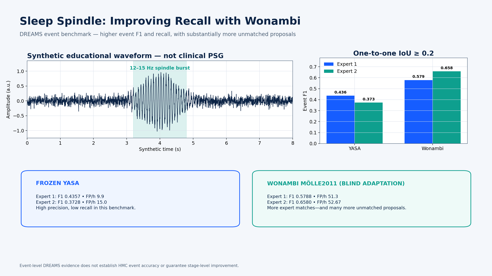
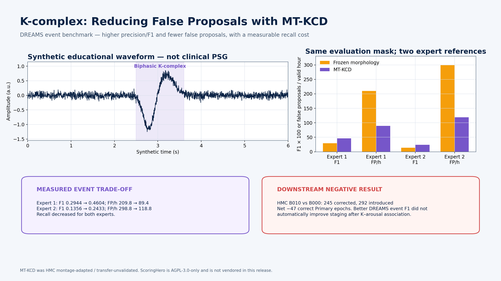
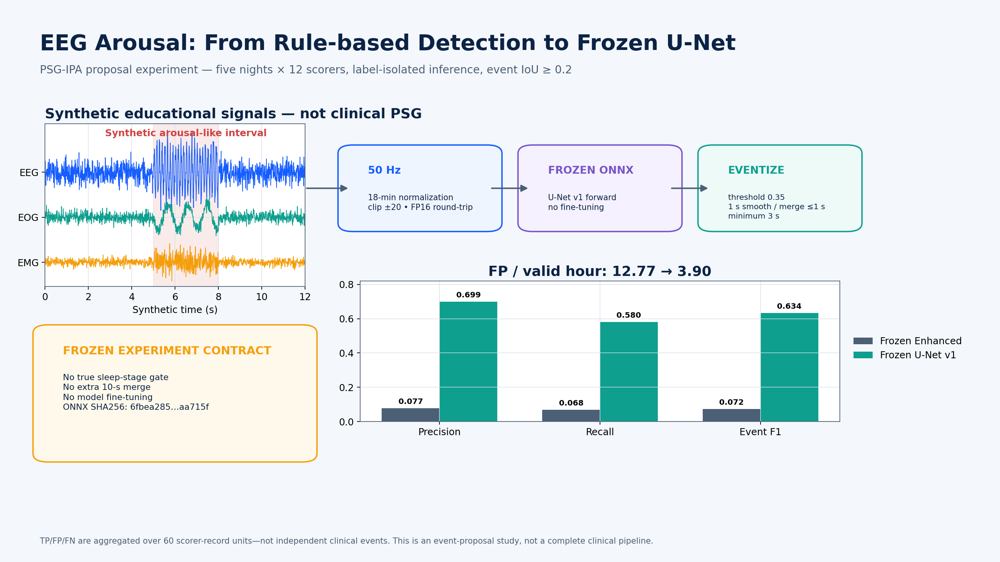
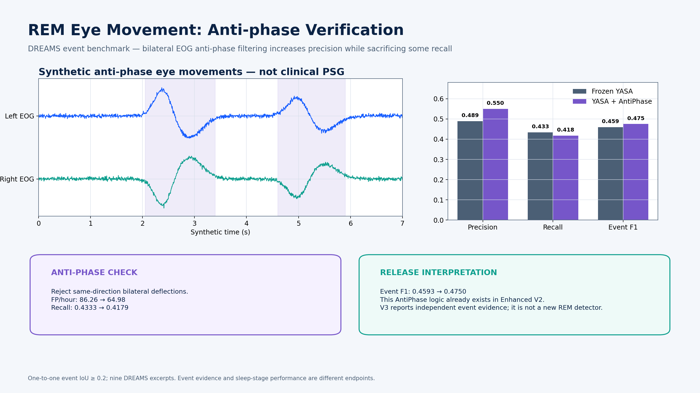

# V3 physiological event-detector evidence

This report separates **event-level benchmarks** from **sleep-stage outcomes**.
The public numbers below were transcribed from the sealed machine-readable
artifacts identified by SHA256 in
[`v3_evidence_summary.json`](v3_evidence_summary.json). No detector was rerun
and no threshold was selected for this release.

## Sleep spindle — DREAMS

Primary matching used one-to-one event assignment at IoU ≥ 0.2 with each
expert's valid-time mask.

| Expert | Detector | Precision | Recall | F1 | FP / valid h |
|---|---|---:|---:|---:|---:|
| Expert 1 | YASA V1-compatible | 0.8268 | 0.2958 | 0.4357 | 9.9 |
| Expert 1 | Wonambi Mölle2011 blind adaptation | 0.6262 | 0.5380 | 0.5788 | 51.3 |
| Expert 2 | YASA V1-compatible | 0.6980 | 0.2543 | 0.3728 | 15.0 |
| Expert 2 | Wonambi Mölle2011 blind adaptation | 0.6376 | 0.6797 | 0.6580 | 52.67 |

Wonambi increased recall and event F1 for both references, but FP/hour rose
substantially. This establishes a bounded DREAMS trade-off; it does not establish
HMC event accuracy. In the earlier V1-style HMC replacement, staging changed by
net −8 correct Primary epochs. In the fixed Temporal R1 factorial experiment,
B001 changed the net count by +49. These are different engines and should not be
presented as the same experiment.

## K-complex — DREAMS

| Expert | Detector | Precision | Recall | F1 | FP / valid h |
|---|---|---:|---:|---:|---:|
| Expert 1 | Frozen morphology, Cz-adapted | 0.1785 | 0.8382 | 0.2944 | 209.8 |
| Expert 1 | ScoringHero MT-KCD | 0.3248 | 0.7904 | 0.4604 | 89.4 |
| Expert 2 | Frozen morphology, Cz-adapted | 0.0732 | 0.9219 | 0.1356 | 298.8 |
| Expert 2 | ScoringHero MT-KCD | 0.1441 | 0.7812 | 0.2433 | 118.8 |

MT-KCD reduced false proposals and improved precision/F1; recall decreased.
The HMC use was explicitly `MONTAGE_ADAPTED / TRANSFER_UNVALIDATED` on F4-M1.
Under frozen Temporal R1, B010 produced 245 corrections and 292 introduced
errors (net −47), so the DREAMS event gain did not translate into a stage gain.
Without HMC K-complex labels, stage accuracy cannot be used to infer HMC event
precision.

## Arousal — PSG-IPA

The main experiment used five nights and 12 same-centre scorers. Inference was
label-isolated: EEG + EOG + Chin EMG were resampled to 50 Hz; the original v1
ONNX forward was frozen; threshold 0.35, 1-second smoothing, gap merge ≤1 second,
and minimum duration 3 seconds were fixed. No true sleep-stage gate, extra
10-second merge, or fine-tuning was used.

| Metric | Frozen Enhanced | PSGScoring U-Net v1 ungated |
|---|---:|---:|
| Unique candidates | 545 | 536 |
| Evaluable unique candidates | 541 | 507 |
| Precision | 0.0767 | 0.6989 |
| Recall | 0.0679 | 0.5798 |
| Event F1 | 0.0720 | 0.6338 |
| FP / valid h | 12.77 | 3.90 |

TP/FP/FN were aggregated across 60 scorer-record units. They are not counts of
independent clinical events. The five nights and scorers are not an external,
multi-centre clinical validation. The source is
[`bartromb/psgscoring`](https://github.com/bartromb/psgscoring) commit
`7271cb089feacb585332ed0db8a375019548702d`; the verified ONNX SHA256 is
`6fbea2857567f95023e6dd34461fba92cab238c9c334dbe9d66494b258aa715f`.
Weights are not distributed here.

## REM eye movement — DREAMS

| Detector | Precision | Recall | F1 | FP / valid h |
|---|---:|---:|---:|---:|
| Frozen YASA REM | 0.4886 | 0.4333 | 0.4593 | 86.26 |
| Frozen YASA + AntiPhase | 0.5502 | 0.4179 | 0.4750 | 64.98 |

AntiPhase raised precision/F1 and reduced FP/hour, with a small recall loss.
This logic already exists in Enhanced V2. V3 reports its independent event
benchmark; it does not claim a newly introduced REM algorithm.

## Evidence boundary

- Event F1 and stage Macro-F1 are different endpoints.
- DREAMS and PSG-IPA results cannot be ranked as if they used one dataset or one
  event definition.
- HMC has no independent expert event truth for these replacements.
- Candidate absence is not a clinically confirmed event absence.
- Better event evidence can still alter K–arousal association, rule priority,
  REM termination, N2 interruption, and inheritance in harmful ways.
