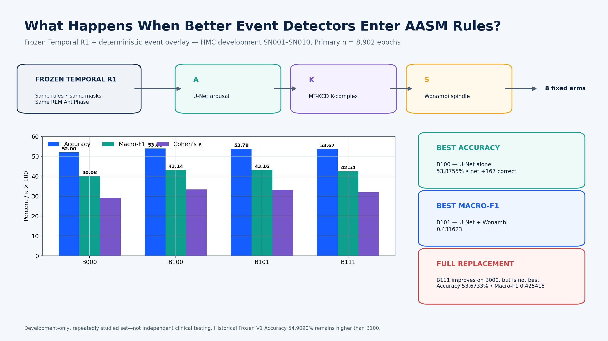

# Full event-detector integration under frozen Temporal R1

The integration fixed the rules, masks, record set, and REM AntiPhase evidence,
then varied only three event-proposal factors:

- **A** — PSGScoring frozen U-Net v1 arousal;
- **K** — ScoringHero MT-KCD K-complex;
- **S** — Wonambi Mölle2011 spindle.

All results are pooled over the repeatedly used HMC development recordings
SN001–SN010. Primary contains 8,902 epochs; Full-valid contains 9,211. This is a
controlled development-set comparison, not independent clinical testing.

## Primary-mask eight-arm results

| Arm | A | K | S | Accuracy | Macro-F1 | κ | Coverage |
|---|:---:|:---:|:---:|---:|---:|---:|---:|
| B000 | — | — | — | 0.519996 | 0.400815 | 0.292166 | 0.993934 |
| B100 | ✓ | — | — | **0.538755** | 0.431424 | **0.333396** | 0.993822 |
| B010 | — | ✓ | — | 0.514716 | 0.390478 | 0.278105 | 0.994159 |
| B001 | — | — | ✓ | 0.525500 | 0.404831 | 0.297730 | 0.994383 |
| B110 | ✓ | ✓ | — | 0.534150 | 0.422753 | 0.317449 | 0.993934 |
| B101 | ✓ | — | ✓ | 0.537857 | **0.431623** | 0.330370 | 0.993934 |
| B011 | — | ✓ | ✓ | 0.522579 | 0.396384 | 0.286352 | 0.993934 |
| B111 | ✓ | ✓ | ✓ | 0.536733 | 0.425415 | 0.318831 | 0.993934 |

Best Accuracy was B100; best Macro-F1 was B101. Full replacement B111 was not
optimal. The same-batch historical Frozen V1 Accuracy was 0.549090, still above
B100's 0.538755; V1 and Temporal R1 differ in rule engine and therefore are not
a detector-only causal comparison.

## B000 versus B111 by stage

| Stage | B000 P / R / F1 | B111 P / R / F1 | ΔF1 |
|---|---:|---:|---:|
| Wake | 0.9714 / 0.0578 / 0.1091 | 0.9714 / 0.0578 / 0.1091 | 0.0000 |
| N1 | 0.2130 / 0.2431 / 0.2270 | 0.3251 / 0.4160 / 0.3650 | +0.1379 |
| N2 | 0.5071 / 0.8552 / 0.6367 | 0.5168 / 0.8660 / 0.6473 | +0.0106 |
| N3 | 0.6513 / 0.2484 / 0.3596 | 0.6473 / 0.2464 / 0.3569 | −0.0027 |
| REM | 0.8827 / 0.5420 / 0.6716 | 0.9139 / 0.5028 / 0.6487 | −0.0229 |

The gain concentrated in N1/N2, while REM and N3 regressed slightly and Wake
did not change. This is a mixed stage trade-off, not universal improvement.

## Paired changes relative to B000

| Arm | Corrected | Introduced | Net correct | Rule changed | Evidence IDs changed |
|---|---:|---:|---:|---:|---:|
| B100 | 510 | 343 | **+167** | 2,858 | 3,324 |
| B010 | 245 | 292 | **−47** | 1,685 | 5,386 |
| B001 | 214 | 165 | **+49** | 1,122 | 4,584 |
| B111 | 708 | 559 | **+149** | 3,955 | 6,975 |

Arousal alone produced the largest downstream net change. Interactions were not
additive: the full combination cannot be interpreted as the sum of isolated
causal effects.

## Event counts and mechanisms

| Event type | Frozen | Replacement | Δ | Boundary |
|---|---:|---:|---:|---|
| Arousal | 1,146 | 1,232 | +86 | 1,264 raw U-Net candidates; 32 failed frozen multichannel QC. |
| K-complex | 13,719 | 7,613 | −6,106 | HMC montage-adapted / transfer-unvalidated. |
| Spindle | 6,075 | 15,718 | +9,643 | F4+C4 events were not cross-channel deduplicated. |

U-Net changed N2 interruption and re-entry most strongly. K-complex replacement
changed the association graph before aggregation. Wonambi added many structural
events and could trigger both corrections and N1→N2 errors. REM and N3 direct
detectors stayed frozen, yet their final stages still changed indirectly through
rule priority, continuation, termination, and inheritance.

## Engineering status and preserved failures

- Ten-night sealed computation: 10/10 records and 8/8 arms.
- B000 regression: exact for evidence, prediction, trace, and temporal state.
- Fresh SN001 base-detector smoke: no result after 8,352 seconds.
- Historical strict-isolation violation: one audit enumerated SN011–SN154
  directory names/metadata; no case content, labels, predictions, or hashes were
  read.

Therefore the defensible statement is **integration computation reproducible
from sealed event banks**. This release does **not** claim
`FULL_INTEGRATION_PASS` or fresh raw-EDF end-to-end reproduction.
