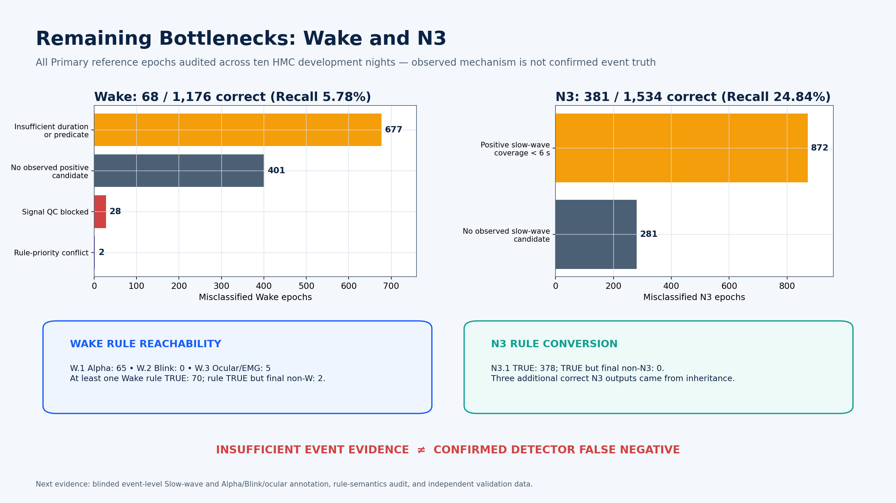

# Limitations and negative results

This release preserves results that constrain the scientific claim. They are
not optional footnotes: they determine what the branch can and cannot support.

## Wake and N3 remain bottlenecks

### Wake

Of 1,176 Primary reference Wake epochs, 68 were correct (Recall 5.7823%).
W.1/W.2/W.3 were reachable for 65/0/5 epochs; at least one Wake rule was true
for 70. The 1,108 errors were partitioned by the earliest observable blocking
layer:

| Primary observable cause | Epochs |
|---|---:|
| Insufficient duration or composite predicate | 677 |
| No observed positive event candidate | 401 |
| Signal QC blocked | 28 |
| Higher-priority rule conflict | 2 |

### N3

Of 1,534 Primary reference N3 epochs, 381 were correct (Recall 24.8370%).
Among the 1,153 errors, 281 had no observed slow-wave candidate and 872 had
positive slow-wave coverage below the frozen 6-second rule threshold. N3.1 was
true for 378 epochs and every one converted to final N3; three additional
correct N3 outputs came from inheritance.

These partitions establish **rule reachability under observed candidates**.
They do not establish Alpha, Blink, ocular, or Slow-wave detector false-negative
rates, because a stage label is not an expert event label. Event truth remains
`UNDETERMINED`.

## Arousal reliability verifier did not establish added value

The frozen U-Net accept-all proposal baseline had F1 0.633823. The main
cross-validated selective policy reduced FP but lowered F1 to 0.616634 and
retained only 92.85% of baseline TP. Its recorded decisions were:

- `CALIBRATION_NOT_ESTABLISHED`;
- `RECALL_PRESERVING_GAIN_NOT_ESTABLISHED`.

The verifier should not be described as an established automatic correction
layer, and it was not used to alter the HMC U-Net candidates in the eight-arm
experiment.

## Frozen SleepFM representations added no reliability value

On the same five previously studied PSG-IPA nights:

| Reliability arm | Brier score | Selective policy F1 |
|---|---:|---:|
| Native U-Net confidence | **0.089698** | **0.620546** |
| SleepFM + native | 0.099049 | 0.611063 |
| SleepFM only | 0.104304 | — |

The prespecified scientific status was
`NO_ADDED_VALUE_FROM_FROZEN_SLEEPFM`. The five nights and same-centre scorers do
not support a broad claim that representations can never help; they show that
this frozen representation experiment did not improve the measured reliability
endpoint.

## Event improvement did not guarantee stage improvement

- Spindle: DREAMS F1 increased for both experts, but an earlier V1-style HMC
  replacement lost eight net correct epochs. Under fixed R1, B001 gained 49.
- K-complex: DREAMS F1 improved and FP/hour fell, but R1 B010 lost 47 net correct
  epochs.
- Arousal: the strongest event proposal result also produced the largest R1
  downstream gain, but full B111 was not the best combination.
- REM AntiPhase: event F1 improved slightly and already belonged to V2; it was
  not a new replacement factor.

Rule-based staging transforms candidates through QC, duration union, composite
evidence, K–arousal association, rule priority, continuation/termination, and
inheritance. A detector can improve one event metric on one dataset while
worsening a downstream stage decision on another dataset.

## Broader limitations

- HMC SN001–SN010 is a repeatedly used development set, not independent blind
  testing.
- MT-KCD and Wonambi are HMC montage-adapted / transfer-unvalidated.
- LAMF, Alpha, EMG tone, Blink, SEM, Vertex, Slowing, MBM, and Slow Wave lack
  equivalent independent expert event validation in this integration study.
- The implemented rules are AASM-inspired research rules, not the complete AASM
  clinical manual and not an AASM-certified product.
- No final141 evaluation is published or implied.
- No confidence interval from ten development recordings should be interpreted
  as large-scale clinical significance.

## Next evidence decision

1. **Priority 1:** blinded, fixed-strata Slow-wave event annotation to separate
   proposal coverage from the 6-second rule definition.
2. **Priority 2:** joint Alpha/Blink/ocular event-truth and Wake-rule semantics
   audit.
3. **Defer:** further Arousal/K/Spindle tuning against HMC stage accuracy or an
   automatic Temporal R2 change.
